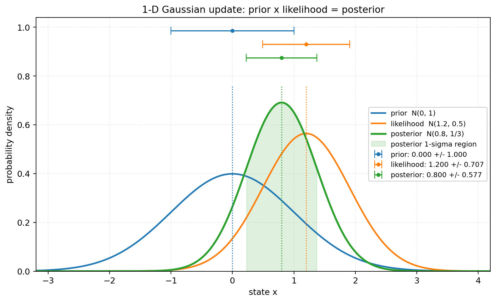
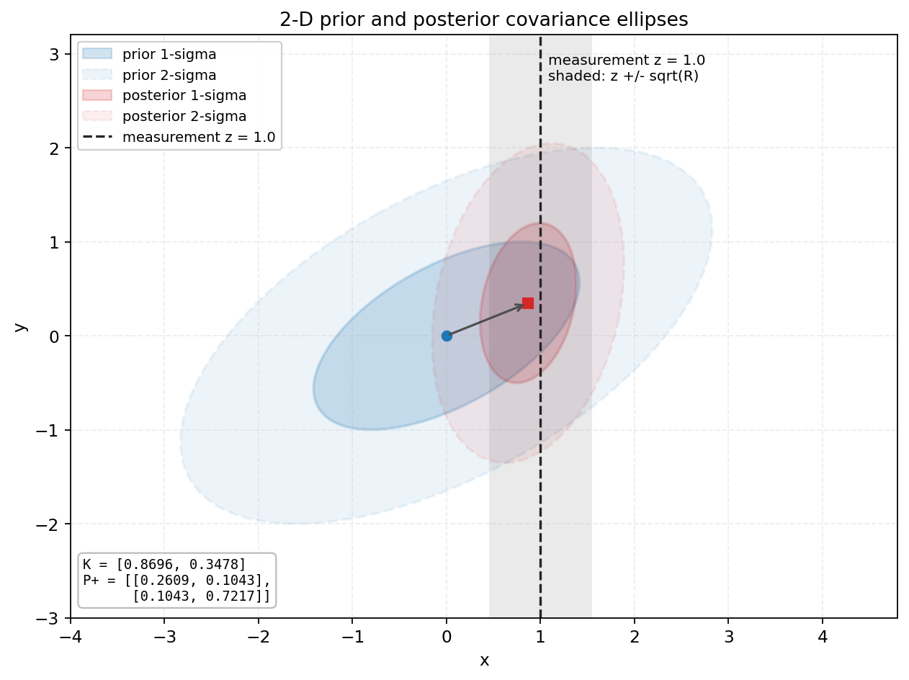
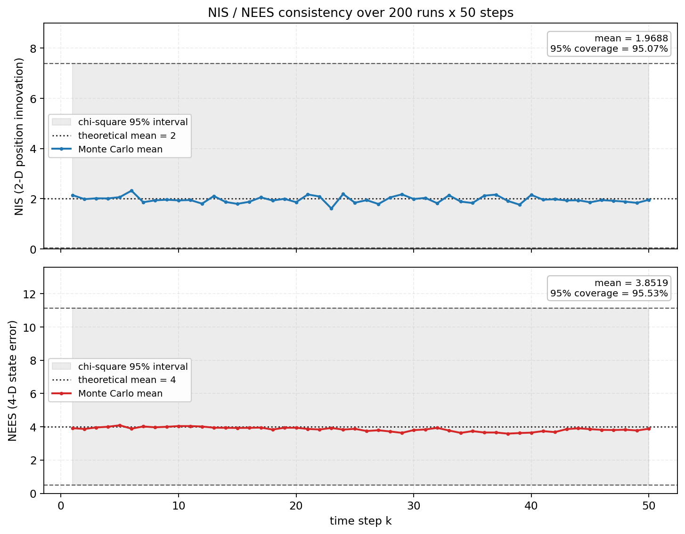
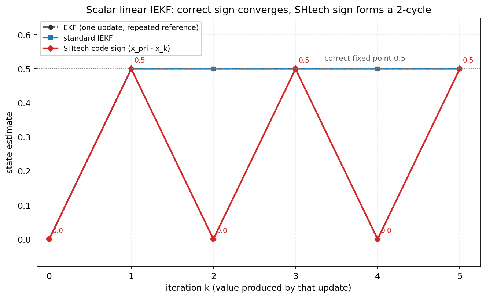
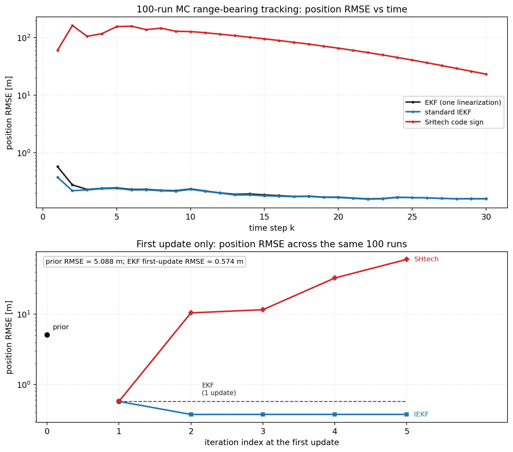
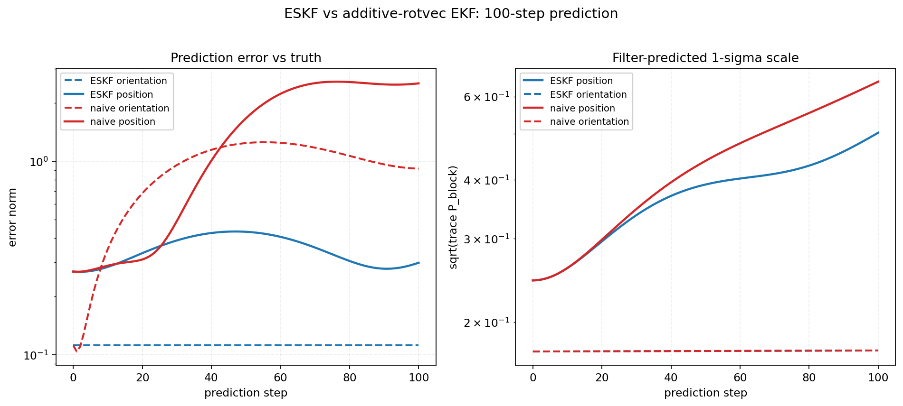

# KF / EKF / IEKF / ESKF 数值验证报告

- 工作区：`/home/zh/RM/autoaim_course`
- 复现：`MPLCONFIGDIR=/tmp/mpl-zh /usr/bin/python3 verify/verify_kf.py`
- 图：`assets/figures/kf_*.png`
- 数值底稿：`verify/kf_results.json`；运行日志：`verify/kf_run.log`
- 环境：Python 3.10.12，numpy 1.21.5，scipy 1.8.0，matplotlib 3.5.1

> 说明：本报告是 `lessons/0005-ekf-eskf-iekf.html` 与主报告第 8 节的数值依据；对照的“课程说法”来自 `MISSION.md`、`RESOURCES.md`，以及 SHtech 源码文件头对 IESEKF 的宣称。所有实验数值均由 `verify/verify_kf.py` 打印并写入 JSON；报告没有修改三个项目仓库中的任何文件。

## 结论摘要

1. **一维 KF 与两个高斯相乘完全等价**：后验均值 `0.8`、方差 `1/3`，解析法与 KF 的最大绝对差 `5.55e-17`，远小于 `1e-12`。
2. **二维协方差更新正确**：`K=[0.869565, 0.347826]`，`P+=[[0.260870,0.104348],[0.104348,0.721739]]`；后验椭圆收缩并向观测移动。
3. **NIS/NEES 在 2D CV 模型上统计一致**：200 次 × 50 步，平均 NIS `1.968760`（期望 2），平均 NEES `3.851905`（期望 4），95% 区间覆盖率分别为 `95.07%` 和 `95.53%`。
4. **SHtech 的 IEKF 先验残差符号写反了**。标量线性例中标准 IEKF 收敛到 `0.5`，代码符号在 `0.5` 与 `0` 之间形成 2-cycle；range-bearing 100 次 MC 中标准 EKF/IEKF 收敛，代码符号的首步位置 RMSE 为 `60.45 m`、末步 `23.21 m`（时间平均 `97.16 m`），不能视为“有偏但可用”。
5. **ESKF 的 inject/box_minus 一致性通过**：最大误差 `1.24e-14`；100 步纯预测中 ESKF 姿态误差 `0.111803 rad`，把 rotvec 当普通向量的朴素法误差 `0.915242 rad`，位置误差 `0.298977 m` 对 `2.521118 m`。

---

## 1. 一维 KF 等价性

### 1.1 公式

先验

$$
p(x)=\mathcal N(x;0,1),
$$

观测模型

$$
z=x+v,\qquad v\sim\mathcal N(0,R),\quad z=1.2,\ R=0.5.
$$

把似然看成固定 `z` 后关于 `x` 的高斯：

$$
p(z\mid x)=\mathcal N(z;x,R)
=\mathcal N(x;z,R).
$$

高斯相乘：

$$
\frac{1}{\sigma_+^2}=\frac{1}{\sigma_-^2}+\frac{1}{R},
\qquad
\mu_+=\sigma_+^2\left(\frac{\mu_-}{\sigma_-^2}+\frac{z}{R}\right).
$$

KF 更新：

$$
K=\frac{P^-}{P^-+R},\qquad
x^+=x^-+K(z-Hx^-),\qquad
P^+=(1-K)P^-.
$$

本例 `H=1`。

### 1.2 数值

解析后验：

- 精度：`1/1 + 1/0.5 = 3`
- 方差：`1/3 = 0.3333333333333333`
- 均值：`(1/3) * (1.2/0.5) = 0.8`

| 量 | 解析高斯相乘 | KF 公式 | 绝对误差 |
|---|---:|---:|---:|
| 均值 | 0.7999999999999999 | 0.7999999999999999 | 0 |
| 方差 | 0.3333333333333333 | 0.3333333333333334 | 5.551e-17 |

`K = 2/3 = 0.6666666666666666`。最大绝对误差 `5.551115e-17 < 1e-12`，通过。

### 1.3 图



**图 1 解读：**

- 蓝线先验 `N(0,1)`，橙线似然 `N(1.2,0.5)`，绿线后验 `N(0.8,1/3)`。
- 后验均值位于先验均值 `0` 与观测 `1.2` 之间，且更靠近观测（因为 `R` 小于先验方差）。
- 三条曲线顶部用圆点和误差棒标出了各自的 `mean ± 1σ`；绿色阴影是后验的 1σ 区域。
- 后验峰值高于先验和似然，方差小于两者，符合“乘积更尖”的直觉。

---

## 2. 二维协方差椭圆

### 2.1 公式与设定

先验取 `x^- = [0,0]^T`（题目未指定先验均值，这里明确取零均值）：

$$
P^-=\begin{bmatrix}2&0.8\\0.8&1\end{bmatrix},\quad
H=\begin{bmatrix}1&0\end{bmatrix},\quad
R=0.3,\quad z=1.0.
$$

$$
S=HP^-H^T+R=2.3,
$$

$$
K=P^-H^TS^{-1}
=\begin{bmatrix}0.8695652173913044\\0.3478260869565218\end{bmatrix}.
$$

$$
x^+=x^-+K(z-Hx^-)
=\begin{bmatrix}0.8695652173913044\\0.3478260869565218\end{bmatrix},
$$

$$
P^+=(I-KH)P^-
=\begin{bmatrix}
0.2608695652173911 & 0.1043478260869565\\
0.1043478260869565 & 0.7217391304347825
\end{bmatrix}.
$$

### 2.2 数值

| 量 | 数值 |
|---|---:|
| `S` | 2.3 |
| `K` | `[0.8695652174, 0.3478260870]` |
| `x^+` | `[0.8695652174, 0.3478260870]` |
| `P^+_11` | 0.2608695652 |
| `P^+_12=P^+_21` | 0.1043478261 |
| `P^+_22` | 0.7217391304 |
| `eig(P^-)` | `[0.55660189, 2.44339811]` |
| `eig(P^+)` | `[0.23834455, 0.74426414]` |

### 2.3 图



**图 2 解读：**

- 蓝色是 `P^-` 的 1σ（实线）和 2σ（虚线）椭圆；红色是 `P^+` 的对应椭圆。
- 先验椭圆沿正相关方向拉长；后验椭圆在 x 方向明显变窄，说明 `z` 主要约束了 x。
- 观测 `z=1.0` 用竖虚线表示，浅灰带是 `z ± sqrt(R)` 的观测不确定度；后验均值 `x≈0.870` 向观测靠近但没有完全等于 1，这是先验仍在起作用。
- 由于 `P^-` 的 x-y 相关项为 `0.8`，更新后 y 的均值也被“拉”到 `0.348`。后验 y 方差从 `1` 降到 `0.722`，这是观测 x 通过相关性带来的间接信息，并非数值错误。

---

## 3. NIS / NEES 蒙特卡洛

### 3.1 模型与统计量

二维常速度模型，状态

$$
x=[p_x,p_y,v_x,v_y]^T,
$$

$$
F=\begin{bmatrix}
1&0&dt&0\\
0&1&0&dt\\
0&0&1&0\\
0&0&0&1
\end{bmatrix},\qquad
H=\begin{bmatrix}
1&0&0&0\\0&1&0&0
\end{bmatrix}.
$$

过程噪声按连续白噪声加速度离散化：

$$
G=\begin{bmatrix}dt^2/2&0\\0&dt^2/2\\dt&0\\0&dt\end{bmatrix},
\qquad Q=qGG^T,
$$

参数 `dt=0.1`、`q=0.05`、`R=0.2 I`。初始协方差 `P0=diag(0.25,0.25,0.5,0.5)`；真值初值固定，滤波器初值误差采样自 `N(0,P0)`。

NIS（归一化新息平方，更新前）：

$$
\nu_k=z_k-Hx_k^-,\quad
S_k=HP_k^-H^T+R,\quad
\mathrm{NIS}_k=\nu_k^TS_k^{-1}\nu_k.
$$

量测维数 `m=2`，所以 `NIS ~ χ²_2`。

NEES（归一化估计误差平方，更新后）：

$$
e_k=x_k^+-x_k^{\text{true}},\quad
\mathrm{NEES}_k=e_k^T(P_k^+)^{-1}e_k.
$$

状态维数 `n=4`，所以 `NEES ~ χ²_4`。95% 区间用 `scipy.stats.chi2.ppf([0.025,0.975], dof)`。

### 3.2 数值

200 次独立运行 × 每次 50 步，共 `10000` 个样本。

| 统计量 | 样本均值 | 理论均值 | 95% 区间（单个样本） | 区间覆盖率 |
|---|---:|---:|---|---:|
| NIS (df=2) | 1.9687603827 | 2 | `[0.0506356160, 7.3777589082]` | 95.07% |
| NEES (df=4) | 3.8519049614 | 4 | `[0.4844185571, 11.1432867819]` | 95.53% |

逐时刻（对 200 次运行取平均）的范围：

- NIS 时间均值：`[1.614160, 2.322036]`
- NEES 时间均值：`[3.589676, 4.090762]`

覆盖率的定义是：样本落在上述 `2.5%--97.5%` 双侧区间内的比例；不是贝叶斯“置信区间”的解释，而是频率派的一致性检查。

### 3.3 图



**图 3 解读：**

- 上：NIS 的时间均值围绕理论值 2 波动；灰色带是 `χ²_2` 的 95% 样本区间，虚线是上下界。没有持续越界或系统性偏高/偏低。
- 下：NEES 围绕理论值 4 波动；同样落在 `χ²_4` 的 95% 带内。
- 覆盖率 `95.07%` 和 `95.53%` 都接近 95%，说明这套线性高斯模型的 `P`、`Q`、`R` 与采样过程一致，NIS/NEES 实现没有量纲或转置错误。
- 这个实验只说明“实现和模型自洽”，不能替代真实赛道数据的噪声标定。

### 3.4 关于 `0.711` 的跨项目核对

`sp_vision_25/tools/extended_kalman_filter.cpp:66` 中的常量是：

```cpp
constexpr double nis_threshold = 0.711;
```

脚本交叉检查给出：

- `χ²_4` 的 5% 下分位数：`0.710723021397`
- `χ²_4` 的 95% 上分位数：`9.487729036781`

因此 **0.711 是 4 维 NIS 的 5% 下分位，不是 95% 上分位**。如果代码把 `NIS > 0.711` 当作“失败”，在模型一致时约 95% 的帧都会被判失败。这与本报告第 3 节的 2 维 NIS 区间 `[0.0506, 7.3778]` 也不是同一个量，不能混用。这个发现来自项目核对脚本 `verify/verify_output.txt`，本报告的 KF 脚本额外打印了 `χ²_4` 的分位数用于交叉验证。

---

## 4. EKF vs IEKF，标准符号 vs SHtech 代码符号

### 4.1 三种更新

记先验锚点为 `x_pri`，第 `k` 次迭代的工作点为 `x_k`，`x_0=x_pri`。

**标准 EKF**（只在 `x_pri` 线性化一次）：

$$
H=H(x_{pri}),\quad
K=P_{pri}H^T(HP_{pri}H^T+R)^{-1},
$$

$$
x^+=x_{pri}+K[z-h(x_{pri})],\qquad
P^+=(I-KH)P_{pri}.
$$

**标准 IEKF**（任务给定符号）：

$$
x_{k+1}=x_{pri}\oplus K_k
\left[z-h(x_k)+H_k(x_k\ominus x_{pri})\right].
$$

**SHtech 代码符号**（`IESEKF_Double_Armor.hpp:243` 及 `IESEKF.hpp:221`）：

```cpp
Matrix_x1d dx_pri = x_minus(X_pri, X_cur);   // x_pri - x_k
Matrix_x1d dx = K * (innovation + H * dx_pri);
Matrix_x1d X_next = x_add(X_pri, dx);
```

即

$$
x_{k+1}=x_{pri}\oplus K_k
\left[z-h(x_k)+H_k(x_{pri}\ominus x_k)\right].
$$

差别只在先验残差的符号：标准是 `x_k - x_pri`，代码是 `x_pri - x_k`。`x_minus()` 在 `predict/Tracker.cpp:747-755` 确实实现为 `x1-x2`（只对 yaw 做角度归一化），所以这不是命名歧义，而是实打实的符号反转。

### 4.2 标量线性例：精确数值

设定 `x_pri=0, P=1, H=1, R=1, z=1`，因此

$$
K=\frac{1}{1+1}=0.5,\qquad x^+=0.5.
$$

| 迭代 `k` | EKF | 标准 IEKF | SHtech 代码符号 |
|---:|---:|---:|---:|
| 0（初始） | 0.000000000000 | 0.000000000000 | 0.000000000000 |
| 1 | 0.500000000000 | 0.500000000000 | 0.500000000000 |
| 2 | 0.500000000000 | 0.500000000000 | 0.000000000000 |
| 3 | 0.500000000000 | 0.500000000000 | 0.500000000000 |
| 4 | 0.500000000000 | 0.500000000000 | 0.000000000000 |
| 5 | 0.500000000000 | 0.500000000000 | 0.500000000000 |

推导：

- 标准 IEKF：
  $$
  x_{k+1}=0+0.5\left[1-x_k+1\cdot(x_k-0)\right]=0.5.
  $$
  第一次迭代就到达正确后验，之后是不动点。
- SHtech 代码符号：
  $$
  x_{k+1}=0+0.5\left[1-x_k+1\cdot(0-x_k)\right]=0.5-x_k.
  $$
  从 `x_0=0` 出发得到 `0.5, 0, 0.5, 0, ...`，严格 2-cycle。

SHtech 序列的代数不动点满足 `x=0.5-x`，即 `x=0.25`，但该点不是后验 `0.5`；而且迭代映射的导数是 `-1`，模长等于 1，所以它本来也不会收敛。5 次迭代恰好停在 `0.5`（奇偶性），如果只看 `max_iter=5` 的最终值，会误以为它“算对了”；4 次迭代则返回 `0`。这是本实验最值得写进测试用例的陷阱。



**图 4 解读：**

- 蓝线标准 IEKF 从 0 一步到 0.5 后保持不变。
- 红线 SHtech 在 0 和 0.5 之间来回跳，节点上的 `0.0/0.5` 标注就是实际返回值。
- 灰色点线是正确的后验 `0.5`；红色轨迹始终没有收敛到它。

### 4.3 Range-bearing：100 次蒙特卡洛

状态 `[x,y,vx,vy]`，量测 `[range,bearing]`：

$$
h(x)=\begin{bmatrix}\sqrt{x^2+y^2}\\\operatorname{atan2}(y,x)\end{bmatrix},
\qquad
H(x)=\begin{bmatrix}
x/r & y/r & 0 & 0\\
-y/r^2 & x/r^2 & 0 & 0
\end{bmatrix}.
$$

参数：

| 项 | 值 |
|---|---:|
| `dt` | 0.1 s |
| 步数 | 30 |
| MC 次数 | 100 |
| `q` | 0.5 |
| `sigma_range` | 0.3 m |
| `sigma_bearing` | 0.006 rad |
| `P0` | `diag(16,16,4,4)` |
| 初始误差（真值 - 先验） | `[4,-3,0.8,-0.4]` |
| 初值位置 RMSE | 5.087698 m |

三种方法从同一个先验、同一组真值和量测出发；每种方法独立传播自己的 `P`。迭代上限均为 5，标准 IEKF 的收敛阈值 `1e-8`。

**整体统计（位置误差单位 m，速度误差单位 m/s）：**

| 方法 | 首步位置 RMSE | 时间平均位置 RMSE | 末步位置 RMSE | 末步速度 RMSE | 末步位置误差中位数 | 平均迭代数 |
|---|---:|---:|---:|---:|---:|---:|
| EKF | 0.574227 | 0.219882 | 0.159391 | 0.282822 | 0.134431 | 1.0000 |
| 标准 IEKF | 0.375111 | 0.200066 | 0.158986 | 0.282742 | 0.136727 | 4.0643 |
| SHtech 代码符号 | 60.453136 | 97.158937 | 23.210411 | 33.460098 | 21.475628 | 5.0000 |

**第一次 update 的逐迭代位置 RMSE（同一 100 次运行）：**

| 迭代 | EKF | 标准 IEKF | SHtech 代码符号 |
|---:|---:|---:|---:|
| 先验（迭代 0） | 5.087698 | 5.087698 | 5.087698 |
| 1 | 0.574227 | 0.574227 | 0.574227 |
| 2 | —（不再迭代） | 0.374594 | 10.465763 |
| 3 | — | 0.375110 | 11.600720 |
| 4 | — | 0.375111 | 32.819540 |
| 5 | — | 0.375111 | 60.453136 |

**收敛结论：**

- **EKF：收敛**。首步之后误差在 `0.16 m` 量级，末步 `0.159391 m`。
- **标准 IEKF：收敛**。首步 `0.375111 m`，约为 EKF 的 `0.574227 m` 的 65%；全程时间平均 `0.200066 m`，约为 EKF 的 `0.219882 m` 的 91%；末步与 EKF 基本相同（`0.158986` 对 `0.159391`）。
- **SHtech 代码符号：不收敛，严重偏离**。第一次迭代与 EKF 相同，但从第二次开始误差跳到 `10.47 m`，到第 5 次已到 `60.45 m`；100 次运行的所有数值仍然有限，但整体始终远离真值，末步位置 RMSE `23.21 m`、速度 RMSE `33.46 m`。这不是“小偏差”，而是迭代符号错误导致的放大。

为什么代码符号会放大？对线性化后的标量情形，标准迭代映射的局部导数约为 `I-KH`（谱半径 ≤1），代码符号的映射导数约为 `-2KH`。标量例里 `K=H=0.5` 恰好得到 `-1`（临界 2-cycle）；range-bearing 中某些方向的 `KH` 模式更强，`|-2KH|>1`，于是误差在几次迭代内爆炸。5 次上限只是把爆炸截断在第 5 步，不是收敛。



**图 5 解读：**

- 上图：横轴为时间步，纵轴为 100 次运行的位置 RMSE（对数坐标）。EKF 和标准 IEKF 都在亚米级并逐渐下降；SHtech 在几十到上百米，且随时间只缓慢下降，始终没有回到真值附近。
- 下图：只取第一次 update，把同一次 update 内部每次迭代后的位置 RMSE 画出来。迭代 1 三者相同（因为初始工作点都是先验）；标准 IEKF 在第 2 次降到约 `0.375 m` 后收敛；SHtech 则从 `10.47 m` 一路涨到 `60.45 m`。
- 下图也说明：只比较“迭代 5 次后的最终值”是不够的，必须看迭代轨迹；否则可能把 2-cycle 的某个相位当成收敛。

### 4.4 代码层面的结论

1. **符号错误确认**：`IESEKF_Double_Armor.hpp:243` 和 `IESEKF.hpp:221` 都把先验残差写成了 `x_pri - x_cur`。按标准 IEKF，应改为 `x_minus(X_cur, X_pri)`（即 `x_cur - x_pri`），或者保留 `dx_pri` 但在修正量里用减号。
2. **默认 5 次迭代会掩盖标量错误**：标量例 5 次恰好返回 `0.5`，与正确值相同；改成 4 次或 6 次就暴露为 `0`。建议单元测试同时检查迭代 1..6 的轨迹，而不是只看 `max_iter=5` 的返回值。
3. **未收敛时协方差不可信**：`P_post = (I-KH)P_pri` 用的是最后一次迭代的 `K,H`；如果状态还在 2-cycle 或爆炸，`P_post` 没有概率意义。range-bearing 中状态已经到几十米，但协方差仍可能看起来“正常”。
4. **对课程宣称的含义**：SHtech 文件头宣称 IESEKF “显著解决高速旋转和强非线性系统下的线性化误差”，但按当前代码符号，这个宣称不成立；即使修好符号，本次较温和的 range-bearing 实验中标准 IEKF 的时间平均 RMSE 约为 EKF 的 91%、末步误差基本不变，不能外推成“显著解决所有强非线性”。

---

## 5. ESKF / SO(3)

### 5.1 定义与一致性

实现：

$$
\operatorname{Exp}:\mathbb R^3\to SO(3),\qquad
\operatorname{Log}:SO(3)\to\mathbb R^3,
$$

$$
\operatorname{inject}(\delta,x)
=\left(p+\delta p,\ R\operatorname{Exp}(\delta\theta)\right),
$$

即位置加法、姿态右乘。`box_minus` 采用“从 x 到 y 的切空间误差”：

$$
\operatorname{box\_minus}(x,y)
=\begin{bmatrix}p_y-p_x\\ \operatorname{Log}(R_x^TR_y)\end{bmatrix}.
$$

因此任务要求的恒等式是

$$
\operatorname{box\_minus}\left(x,\operatorname{inject}(\delta,x)\right)=\delta.
$$

200 组随机测试（位置随机，姿态随机，`|δθ|` 在 `1e-6` 到 `2.8 rad` 之间）：

| 检查 | 最大绝对误差 |
|---|---:|
| `box_minus(x, inject(delta,x)) - delta` | `1.2434e-14` |
| `Log(Exp(phi)) - phi` | `1.1990e-14` |

都远小于 `1e-9`，通过。注意 `box_minus` 的参数顺序是“起点 x，终点 y”；如果按 `x⊖y` 的相反顺序调用，结果会是 `-delta`，这是接口约定问题，不是数学错误。

### 5.2 预测传播

误差定义采用右扰动：

$$
p=p_{nom}+\delta p,\qquad
R=R_{nom}\operatorname{Exp}(\delta\theta).
$$

真实系统以机体系常速度 `v` 和常角速度 `ω` 传播：

$$
p_{k+1}=p_k+R_kv\,dt,\qquad
R_{k+1}=R_k\operatorname{Exp}(\omega dt).
$$

一阶误差传播为：

$$
\delta p_{k+1}=\delta p_k-R_{nom}[v]_\times\delta\theta_k\,dt,
$$

$$
\delta\theta_{k+1}
=\operatorname{Ad}_{\operatorname{Exp}(-\omega dt)}\delta\theta_k
=\operatorname{Exp}(-\omega dt)\delta\theta_k.
$$

所以

$$
F=\begin{bmatrix}
I & -R_{nom}[v]_\times dt\\
0 & \operatorname{Exp}(-\omega dt)
\end{bmatrix},
\qquad
P_{k+1}=FP_kF^T+Q.
$$

“朴素欧氏 EKF”则把姿态的 rotvec `φ` 当普通向量：

$$
\phi_{k+1}=\phi_k+\omega dt,\qquad
R(\phi_{k+1})=\operatorname{Exp}(\phi_{k+1}),
$$

位置更新仍用 `R(φ)v dt`，协方差用对应的加法坐标雅可比。它没有把姿态误差限制在切空间，也没有用 `Ad` 传播姿态协方差。

### 5.3 100 步数值

设定：`dt=0.05`，100 步（5 s）；`v=[1.2,0.3,-0.2]`，`ω=[1.0,-0.6,0.8]`（总转角 `7.071068 rad`）；初始位置误差 `[0.2,-0.1,0.15]`，初始姿态误差 `[0.08,-0.05,0.06]`；`P0=diag(0.02,0.02,0.02,0.01,0.01,0.01)`，`Q=1e-6 I`。这是**纯预测、无观测更新**的对比。

| 指标（100 步后） | ESKF | 朴素加法 rotvec |
|---|---:|---:|
| 位置误差范数 | 0.298977 m | 2.521118 m |
| 姿态误差（测地线） | 0.111803 rad | 0.915242 rad |
| 位置协方差 trace | 0.253099 | 0.416286 |
| 姿态协方差 trace | 0.030300 | 0.030300 |
| 展开后的 rotvec 范数 | — | 8.046422 rad |

- ESKF 的姿态误差保持在初始 `0.111803 rad`（因为真值与名义值都右乘同一个 `Exp(ωdt)`，相对姿态不变）；位置误差由初始姿态误差积分产生，约 `0.299 m`，与预测协方差量级一致。
- 朴素法的姿态误差增长到 `0.915 rad`，位置误差 `2.521 m`；但它报告的姿态协方差仍然是 `0.0303`（1σ 约 `0.174 rad`），远小于实际误差，说明协方差已经过度自信/失真。
- 朴素法的 rotvec 已累加到 `8.046 rad`，超过 `2π`；把大角度 rotvec 当普通向量做加法，语义上已经不再对应物理旋转。ESKF 的姿态始终是 `SO(3)` 矩阵，不存在这个展开/回绕问题。



**图 6 解读：**

- 左图：ESKF 姿态误差（蓝虚线）几乎水平；朴素法姿态误差（红虚线）从 `0.11 rad` 涨到 `0.92 rad`。位置误差（实线）也从 `0.30 m` 对 `2.52 m`。
- 右图：两种方法报告的“1σ 尺度” `sqrt(trace(P_block))`。ESKF 的位置协方差与真实误差量级一致；朴素法的位置协方差更大，但仍远不能覆盖 `2.52 m` 的实际误差；姿态协方差两者数值相同（因为两者姿态协方差初值相同、在各自模型下 trace 不变），但朴素法的实际姿态误差已经远大于它。
- 右图也暴露一个细节：**协方差大小本身不是正确性的证明**。朴素法的 `P` 看起来“有值”，但它所在的参数化和实际误差不匹配。

**限制**：本实验只验证了 `Exp/Log`、`inject/box_minus` 的一致性和预测传播，没有实现完整的 ESKF 观测更新（需要定义量测雅可比、切空间增益和注入后的协方差重置）。因此它支持“流形误差状态预测优于加法 rotvec”，但不能据此宣称完整的 ESKF 更新已在所有观测模型上验证。

---

## 6. 这些实验如何支持/反驳课程里的说法

> 课程当前没有 lesson 正文；以下对照的是 `MISSION.md` 的验收目标、`RESOURCES.md` 的参考条目，以及 SHtech 文件头注释。

| 课程/代码中的说法 | 本报告的检验 | 判断 |
|---|---|---|
| “能用 Python 复现 1D KF” | 第 1 节：解析乘积与 KF 误差 `5.55e-17` | **支持** |
| “理解协方差椭圆、NIS/NEES” | 第 2、3 节：2D 更新精确，NIS/NEES 覆盖率约 95% | **支持**（限于线性高斯自洽模型） |
| “EKF/IEKF 收敛” | 第 4 节：标准 EKF/IEKF 收敛；SHtech 代码符号不收敛 | **部分支持，代码实现需修正** |
| SHtech 注释：“IESEKF 显著解决高速旋转和强非线性下的线性化误差” | 第 4 节：代码符号造成 2-cycle/爆炸；修好符号后本次实验的 IEKF 时间 RMSE 约为 EKF 的 91%，末步不变 | **按当前代码反驳**；修好后也只能说“有条件改善”，不能说“显著解决一切” |
| `RESOURCES.md` 推荐 Solà 的 ESKF | 第 5 节：inject/box_minus 一致，预测中 ESKF 明显优于加法 rotvec | **支持预测部分**；完整更新未验证 |
| `sp_vision_25` 的 `nis_threshold=0.711` | `χ²_4` 的 5% 下分位是 `0.710723`，不是 95% 上界 | **异常/需复核**：若 `NIS>0.711` 判失败，一致模型下约 95% 帧会失败 |

### 6.1 对 IEKF 符号实验的明确结论

**标准符号正确，SHtech 代码符号错误。** 错误不是“数值精度”或“角度 wrapping”问题，而是先验残差方向反了；在标量线性例中它直接把收敛映射变成 2-cycle，在 range-bearing 中它把 100 次 MC 全部推离真值。只要 `x_add/x_minus` 是普通加法/减法，正确写法就应是：

```cpp
Matrix_x1d dx_pri = x_minus(X_cur, X_pri);   // x_k - x_pri
```

如果代码作者想保留 `dx_pri = x_pri - x_cur` 的命名，则应在修正量中使用 `innovation - H * dx_pri`，而不是 `innovation + H * dx_pri`。两种写法等价，但不能像当前代码那样“反向残差 + 加号”。

### 6.2 对 NIS 阈值 `0.711` 的明确结论

`0.711` 是 **4 维 NIS 的 5% 下分位**（`χ²_4` 的 5% 分位 `0.710723`），不是 95% 上界。若用它作为“NIS 超过即失败”的门限，则模型一致时约 95% 的帧会被判失败。这个结论和本报告第 3 节的 2 维 NIS 实验是两件事；第 3 节的 95% 双侧区间是 `[0.0506, 7.3778]`，不能拿 `0.711` 去套。

---

## 7. 异常、限制与复现

### 7.1 发现的主要异常

1. **SHtech 两处 IESEKF 实现的先验残差符号相反**：`mathutils/IESEKF_Double_Armor.hpp:243`、`mathutils/IESEKF.hpp:221`。两份文件都有同样问题；且 `Tracker.cpp:766-769` 用 `max_iter=5, stop_threshold=1e-4`，在 2-cycle 下阈值永远不会触发。
2. **5 次迭代的标量测试会假阳性**：5 次迭代返回 `0.5`，4/6 次返回 `0`。测试必须检查迭代历史或 4/6 次。
3. **`sp_vision_25` 的 NIS 门限方向可疑**：`0.711` 是 5% 下分位，不是 95% 上界。
4. **未收敛时协方差无意义**：SHtech 的 `P_post` 用最后一次迭代的 `K,H` 计算，而状态已经偏离几十米；不要把这种协方差当作可信不确定度。

### 7.2 限制

- 第 3 节的 NIS/NEES 是**线性高斯、模型完全匹配**的自洽性测试；它不检验真实赛道中的非高斯噪声、时间延迟、PnP 深度噪声或机动模型失配。
- 第 4 节的 range-bearing 是较温和的几何和噪声；结论“标准 IEKF 仅小幅改善”只适用于这个场景，不能外推到所有强非线性场景。
- 第 5 节是单条确定性轨迹的 100 步纯预测，没有 Monte Carlo，也没有 ESKF 观测更新；它验证的是注入一致性和预测协方差，不是完整 ESKF。
- 1D/2D 的解析假设是高斯、线性、`R` 已知；实际工程中的 `R` 需要标定。

### 7.3 复现与文件

```bash
cd /home/zh/RM/autoaim_course
MPLCONFIGDIR=/tmp/mpl-zh /usr/bin/python3 verify/verify_kf.py
```

产物：

| 文件 | 内容 |
|---|---|
| `verify/verify_kf.py` | 全部实验脚本，打印所有数值 |
| `verify/kf_report.md` | 本报告 |
| `verify/kf_results.json` | 脚本写出的数值结果 |
| `assets/figures/kf_prior_posterior.png` | 1D prior/likelihood/posterior |
| `assets/figures/kf_cov_ellipse.png` | 2D 1σ/2σ 协方差椭圆 |
| `assets/figures/kf_nis_nees.png` | NIS/NEES 时间曲线与 χ² 界 |
| `assets/figures/kf_iekf.png` | range-bearing RMSE vs 时间/迭代 |
| `assets/figures/kf_iekf_scalar.png` | 标量 IEKF 2-cycle |
| `assets/figures/kf_eskf.png` | ESKF vs 朴素 rotvec 的误差/协方差 |
