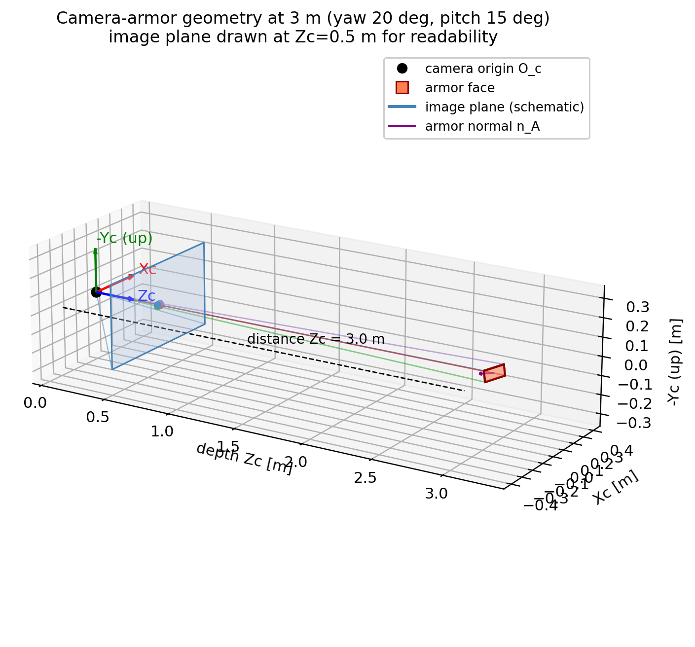
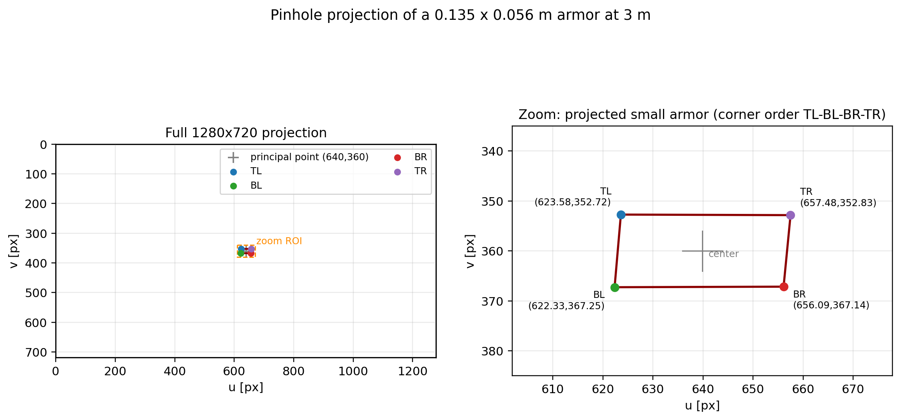
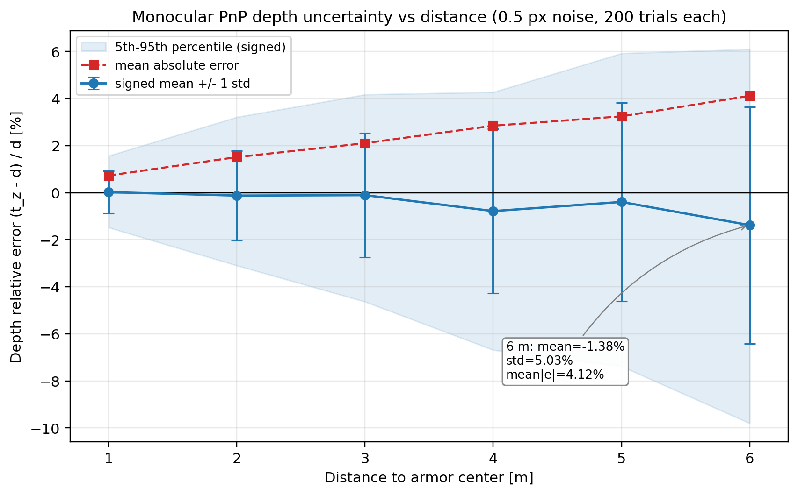
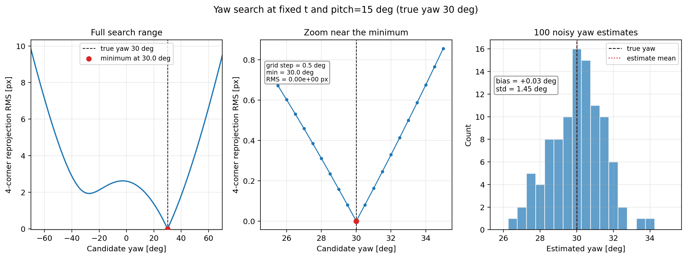
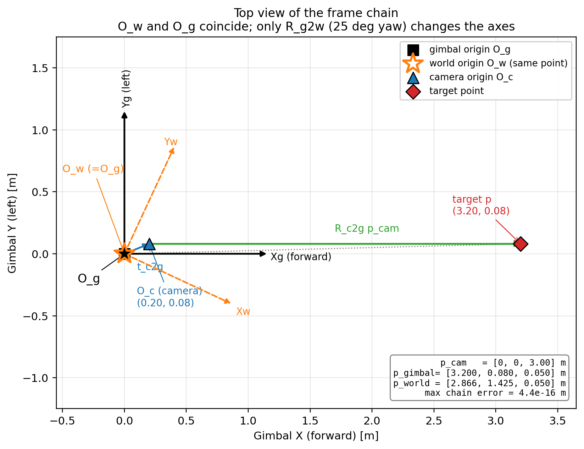
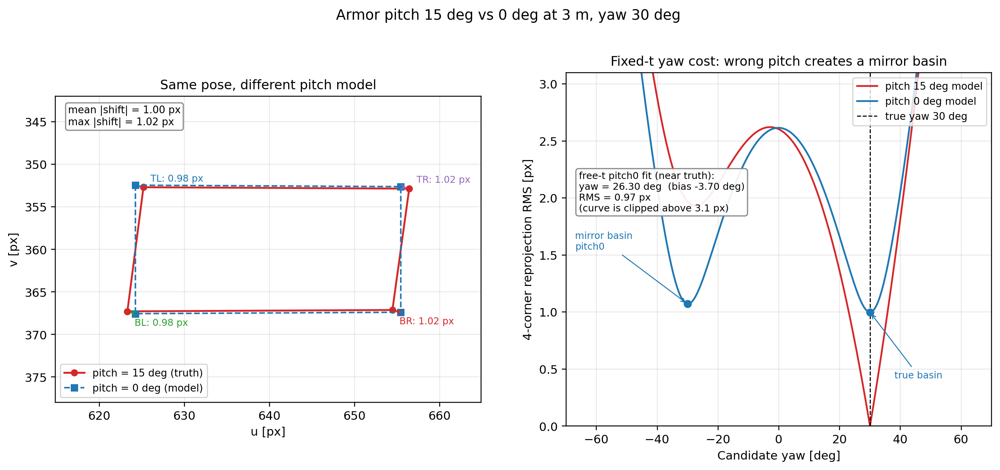

# 针孔投影、PnP、yaw 搜索与坐标系链数值验证

> 复现命令（工作区 `autoaim_course`）：
>
> ```bash
> MPLCONFIGDIR=/tmp/mpl-zh /usr/bin/python3 verify/verify_pnp.py
> ```
>
> 脚本：`verify/verify_pnp.py`；原始完整输出：`verify/pnp_output.txt`。
> 本文所有数值均由该脚本打印，图均由该脚本生成后人工检查。
> 除 `verify/` 与 `assets/figures/` 外未修改任何文件。

## 0. 结论速览

1. **PnP 单次可以很准，但平面 IPPE 的双解在 0.5 px 噪声下会频繁选错。** 200 次中 `solvePnPGeneric` **全部返回 2 个解**，两个解都满足“正面朝相机”，旋转相差约 **49.6°**，但重投影代价只差 **0.056 px**。原始 `solvePnP` 有 **80/200** 次选到了负 pitch 的镜像支；用已知的 `+15°` 俯仰先验选支后，旋转误差从 `23.39±21.56°` 降到 `6.63±4.44°`。
2. **深度误差随距离快速增长。** 6 m 处深度相对误差 `-1.38% ± 5.03%`（均值 ± 1σ），平均绝对误差 `4.12%`、95 分位 `10.87%`；1 m 时平均绝对误差只有 `0.73%`。中心视角下，1 m 的 0.5 px 像素误差只值约 0.6 mm 横向位移，6 m 时值约 3.8 mm，而单目深度还要再放大约 `z/width` 倍，所以 `R` 的深度项必须随距离增大。
3. **固定 `t`、已知 pitch 后，yaw 重投影搜索是良态的。** 无噪声时 0.5° 网格在 `30.0°` 精确取到零残差；100 次 0.5 px 噪声下，yaw 偏差 `+0.03°`、标准差 `1.45°`。这验证了 sp_vision_25 的 `optimize_yaw()` 用“固定 PnP 平移 + 已知 pitch + 一维 yaw 搜索”的合理性。
4. **坐标链严格成立。** 目标点链式结果与直接 `T_world_camera` 的差为 `4.97e-16 m`，1000 个随机点最大误差 `4.44e-16 m`，远小于 `1e-9`。sp_vision_25 的“世界系原点在云台”意味着 `t_gimbal2world = 0`，世界系与云台系只差旋转；它不是场地中心，原点仍随机器人/云台底座平移。
5. **15° 俯仰不能省。** 3 m、yaw=30° 时，pitch 15° 与 0° 的四个角点像素差平均 `1.00 px`、最大 `1.02 px`，已经是 0.5 px 噪声的 2 倍。若用 pitch=0 模型并放开 `t` 去拟合 15° 的角点，yaw 会被拉偏 **-3.70°**、深度被拉远 **+3.51%**，而重投影 RMS 仍有 `0.966 px`——**低重投影误差不代表模型正确**。这正是 sp_vision_25 和 wuhan 在重投影/状态里显式写 `±15°` 的原因；SHtech 的 `h()` 没有 pitch 自由度，只能把这一偏差吸收进 yaw/位置。

---

## 1. 坐标约定与公式

### 1.1 相机、装甲板与角点顺序

相机系 `C` 采用 OpenCV 约定：

- `x_C` 向右，`y_C` 向下，`z_C` 沿光轴向前；
- 内参

\[
K=\begin{bmatrix}800&0&640\\0&800&360\\0&0&1\end{bmatrix},
\qquad 1280\times720.
\]

装甲板局部系 `A` 明确约定为：

- `x_A` 向右（观察者看装甲板正面时的右侧）；
- `y_A` 向上；
- `z_A` 沿板面外法线、指向相机；
- 右手系。正面正对相机时，基础旋转为

\[
R_{CA,0}=\operatorname{diag}(1,-1,-1),
\]

它把 `x_A` 映到相机 `+x`、`y_A` 映到相机 `-y`、`z_A` 映到相机 `-z`。

四个角点在 `A` 系中按 OpenCV 顺序（左上、左下、右下、右上）：

\[
\begin{aligned}
P_{TL}&=(-W/2,+H/2,0),&
P_{BL}&=(-W/2,-H/2,0),\\
P_{BR}&=(+W/2,-H/2,0),&
P_{TR}&=(+W/2,+H/2,0),
\end{aligned}
\]

其中 \(W=0.135\) m，\(H=0.056\) m。

姿态采用

\[
R_{CA}=R_{CA,0}\,R_y(\psi)\,R_x(\theta),
\]

其中 \(\psi\) 是 yaw、\(\theta\) 是 pitch。正 yaw 使板面法线转向相机 `+x`；正 pitch 使上边缘向相机倾斜（俯视时“前倾”）。真实姿态下法线为

\[
n_C=R_{CA}(0,0,1)^T=[0.330366,\;0.258819,\;-0.907673]^T,
\]

与 `yaw=20°、pitch=15°` 一致。

> 注意：sp_vision_25 的装甲板局部系是 `x=法线、y=横向、z=竖直`，对象点为 `(0, ±W/2, ±H/2)`；
> wuhan 也是 `x=法线`。本文为了满足“x 向右”，用了不同的局部轴，但几何和结论等价；
> 不能把本文的 `R` 逐元素和 sp 的 `R_armor2world` 直接比较。

### 1.2 投影、PnP 与误差定义

针孔投影：

\[
s\begin{bmatrix}u\\v\\1\end{bmatrix}
=K\left(R_{CA}P_A+t_{CA}\right).
\]

`cv2.projectPoints` 用上式生成像素。`cv2.solvePnP(..., SOLVEPNP_IPPE)` 在平面靶标上最小化

\[
\min_{R,t}\;\sum_{i=1}^{4}
\left\|\pi\!\left(K,R,t;P_i\right)-u_i\right\|_2^2 .
\]

本文的**重投影 RMS** 定义为四个角点欧氏误差的均方根：

\[
E_{\rm rms}=\sqrt{\frac14\sum_{i=1}^4\|e_i\|_2^2},
\qquad e_i=\hat u_i-u_i .
\]

旋转误差用测地角：

\[
\theta_{\rm rot}
=\arccos\!\left(\frac{\operatorname{tr}(R_{\rm true}^TR_{\rm est})-1}{2}\right),
\]

平移误差用 \(\|t_{\rm est}-t_{\rm true}\|_2\)，单位 mm。角度统计中的“std”均为样本标准差（`ddof=1`）。

yaw 提取自板面外法线：

\[
\psi=\operatorname{atan2}(n_x,-n_z),\qquad
\theta=\arcsin(n_y).
\]

在本文姿态参数化下，该式严格恢复 yaw/pitch。

### 1.3 噪声与随机种子

- 每个角点的 `u`、`v` 分别加独立高斯噪声 \(N(0,0.5^2)\) px；
- 主闭环 200 次，深度每档 200 次，yaw 扫描 100 次，pitch 约束拟合 100 次，畸变每档 200 次；
- 固定种子：闭环 `20261026`，深度 `20261027`，yaw `20261028`，坐标链 `20261029`，pitch `20261030`，畸变 `20261031`。

---

## 2. 投影与 PnP 闭环

### 2.1 设置与无噪声投影

真实位姿：

\[
t_{CA}=[0,0,3]^T\ \text{m},\quad \psi=20^\circ,\quad \theta=15^\circ.
\]

无噪声像素为：

| 角点 | u (px) | v (px) |
|---|---:|---:|
| TL | 623.5829 | 352.7152 |
| BL | 622.3287 | 367.2516 |
| BR | 656.0931 | 367.1411 |
| TR | 657.4806 | 352.8267 |

投影外接框宽 **35.1519 px**、高 **14.5364 px**，中心 `(639.871, 359.984)`。在 1280×720 图中，这块 13.5 cm 的板只占约 35×15 像素，这正是后面深度和姿态噪声大的根源。



**图 `pnp_geometry.png` 解读**：相机在原点，蓝色矩形是画在 `Zc=0.5 m` 的示意像平面（真实投影面不唯一，画近一点便于观察），右侧红色小矩形是 3 m 处的装甲板；彩色细线是四个角点的光线，紫色箭头是板面法线，黑/红/绿箭头分别是相机 `Zc`、`Xc`、`-Yc` 方向。可以看到法线确实有约 20° 的横向和 15° 的俯仰分量；板在 3 m 处相对视场很小。



**图 `pnp_projection.png` 解读**：左图是完整 1280×720 画面，板在图像中心附近，橙色虚线框是放大区域；右图是放大后的四个角点，顺序为 TL→BL→BR→TR。投影不是轴对齐矩形：pitch 使上/下边缘产生轻微错位，yaw 使左右边有透视收缩。角点像素坐标与上表一致。

### 2.2 200 次闭环误差

原始 `cv2.solvePnP(..., IPPE)` 的统计（不做任何分支选择）：

| 指标 | 均值 | 标准差 | 中位数 | 95% \|误差\| |
|---|---:|---:|---:|---:|
| 旋转误差 (deg) | 23.3914 | 21.5567 | 9.5511 | 55.4243 |
| 平移误差 (mm) | 71.0256 | 49.1541 | 64.1804 | 163.6447 |
| 重投影 RMS (px) | 0.2736 | 0.1507 | 0.2595 | 0.5506 |

均值被双解选错拉大，不能只用均值描述这个分布。用**已知的 +15° 俯仰先验**在两个 `solvePnPGeneric` 解中选估计 pitch 更接近 +15° 的一支（不使用真实 yaw/t）：

| 指标 | 均值 | 标准差 | 中位数 | 95% \|误差\| |
|---|---:|---:|---:|---:|
| 旋转误差 (deg) | 6.6341 | 4.4405 | 5.6726 | 12.8975 |
| 平移误差 (mm) | 71.0971 | 49.2083 | 64.1804 | 163.6447 |
| 重投影 RMS (px) | 0.3028 | 0.1533 | 0.2977 | 0.5736 |
| yaw 误差 (deg) | -0.9484 | 6.4029 | -0.2291 | 12.0123 |
| pitch 误差 (deg) | -0.0733 | 4.7255 | -0.1474 | 9.5497 |

选支后平移误差几乎不变，因为镜像支的平移也很接近；误差主要来自深度方向。3 m、0.5 px 时旋转误差仍有约 6.6°（1σ 4.4°），说明**四角点小靶标的姿态本来就不该期待很高精度**，后续滤波器/时域先验不是可选项。

### 2.3 双解：这是本实验最重要的“异常”

`solvePnPGeneric` 的结果：

- 200/200 次返回 **2 个解**；
- 200/200 次**两个解都满足** `n·(-t)>0`（都正面朝相机）；
- 原始 `solvePnP` 选择负 pitch 镜像支 **80/200** 次；
- 原始 `solvePnP` 每次都等于两解中重投影更小的那个（200/200）；
- 两解旋转差 `49.6419 ± 9.4784°`；
- 两解重投影代价差仅 `0.0562 ± 0.0292 px`。

也就是说，两个姿态差约 50°，图像残差却只差 0.06 px，远小于 0.5 px 噪声。于是“选残差小的”在单帧上并不可靠。

对项目的直接含义：

- **wuhan** 在 `armor_target.cpp:179` 用 `solvePnPGeneric`，然后在 `:205` 只检查 `front_normal.dot(-t_eigen)>0`。本实验里这个条件**筛不掉镜像解**；需要 pitch 符号先验或时域一致性。它后面在 `:219` 用固定 `±15°` 的 `rpy2matrix` 再做黄金分割 yaw，能修正姿态朝向，但 `t` 仍来自 PnP。
- **sp_vision_25** 在 `solver.cpp:61` 直接 `solvePnP`，不检查 Generic；不过它在 `solver.cpp:196` 的 `optimize_yaw()` 会用固定 `t` 和 `±15°` pitch 重投影搜索 yaw，相当于用模型先验把姿态重新拉回正确支。这解释了“为什么 PnP 有双解、sp 还能用”：它不依赖 PnP 的 yaw。
- **SHtech** 也只调用一次 `solvePnP`（`CoordTransformer.cpp:177`），同样没有显式双解处理；其鲁棒性更多依赖后续 EKF 的时域平滑。

---

## 3. 深度误差 vs 距离

### 3.1 数值结果（每档 200 次，0.5 px）

深度误差定义为

\[
e_d=\frac{\hat t_z-d}{d}\times100\%.
\]

| 距离 d (m) | 有符号均值 (%) | 标准差 (%) | 平均 \|误差\| (%) | 95% \|误差\| (%) | 平均 \|z 误差\| (mm) |
|---:|---:|---:|---:|---:|---:|
| 1 | +0.024 | 0.907 | 0.728 | 1.801 | 7.28 |
| 2 | -0.124 | 1.913 | 1.514 | 3.641 | 30.27 |
| 3 | -0.106 | 2.634 | 2.104 | 5.238 | 63.11 |
| 4 | -0.783 | 3.491 | 2.846 | 6.687 | 113.86 |
| 5 | -0.393 | 4.222 | 3.245 | 7.875 | 162.24 |
| 6 | **-1.380** | **5.033** | **4.116** | **10.865** | **246.99** |

**6 m 处：**有符号均值 `-1.38%`，标准差 `5.03%`，平均绝对误差 `4.12%`，95 分位 `10.87%`；平均绝对深度误差约 **247 mm**。



**图 `pnp_depth_noise.png` 解读**：蓝点是 200 次的有符号均值，误差棒为 ±1σ；浅蓝带是 5–95 分位；红色虚线是平均绝对误差。均值一直在 0 附近（PnP 深度基本无偏），但分布随距离迅速变宽：1 m 时 ±1σ 只有 0.91%，6 m 时到 5.03%；红色平均绝对误差从 0.73% 单调升到 4.12%。6 m 的 95% 区间跨约 −10% 到 +6%，说明远距离单帧深度不能当作高置信测量。

### 3.2 为什么 R 里的距离项必须随距离增大

设像素噪声标准差为 \(\sigma_{\rm px}\)，焦距为 \(f\)。一个角点的角度噪声近似

\[
\sigma_\alpha \approx \frac{\sigma_{\rm px}}{f}.
\]

在距离 \(d\) 处，同样的角度误差对应的横向位置误差是

\[
\sigma_\perp \approx d\,\sigma_\alpha
= d\,\frac{\sigma_{\rm px}}{f},
\]

所以**横向**位置噪声至少随 \(d\) 线性增长。

深度更差。若用宽度 \(W\) 的像宽 \(w_{\rm px}\approx fW/d\) 估深度，则

\[
d\approx \frac{fW}{w_{\rm px}},\qquad
\frac{\sigma_d}{d}\approx \frac{\sigma_{w}}{w_{\rm px}}
\approx \frac{\sigma_{\rm px}d}{fW},
\]

即**相对深度误差随 \(d\) 线性增长、绝对深度误差随 \(d^2\) 增长**。本实验的平均绝对深度误差从 1 m 的 7.3 mm 到 6 m 的 247 mm，约 34 倍，接近 \(6^2\) 的量级；而板在图像中的高度从 3 m 的 14.5 px 降到 6 m 的约 7.3 px，0.5 px 已占 7%，姿态和深度都会明显变差。

因此：

- 若 `R` 建在相机 Cartesian 位置 `[x,y,z]` 上，径向（深度）方差应显著大于横向，并随距离增长；固定方差会让 6 m 目标被过度信任。
- 若 `R` 建在 `[yaw,pitch,distance]` 上，距离项也不能是常数；至少应按距离缩放，并按实际噪声模型区分径向/切向。
- **SHtech** 在 `Tracker.cpp:700-709` 显式写了 `sigma_pos_tangent = dist_3d * std_dev_azi_angle`、`sigma_pos_z = dist_3d * std_dev_ele_angle`、`sigma_pos_radial = dist_3d * std_dev_dist_coeff`，方向是对的：绝对位置噪声随距离增长，且径向/切向分开。按本实验，深度相对误差本身还随距离上升，所以线性增长的 `sigma_pos_radial` 在 6 m 可能仍偏乐观，但比常数模型合理得多。
- **sp_vision_25** 的 `target.cpp:194-199` 用 `R_dig` 对角阵，其中距离项主要由 `|delta_angle|` 的 `log` 调整，而不是按距离增长；这更像“角度失配启发式”，不能替代按距离缩放的深度噪声。远距离时应额外放大距离方差。
- **wuhan** 的观测主要在归一化灯条坐标上建模（`armor_target.cpp:376-395` 用像素长度比例生成 `sigma_x/sigma_y/sigma_length`），像素噪声转换到归一化坐标后会随焦距缩放；它的深度不确定性仍需要靠过程噪声/多帧滤波承担，单帧远距离同样不能过度自信。

---

## 4. yaw 重投影搜索

### 4.1 无噪声扫描

固定：

\[
t=[0,0,3]^T,\quad \theta=15^\circ,\quad \psi_{\rm true}=30^\circ,
\]

在 \(-70^\circ\le\psi\le70^\circ\) 上以 0.5° 步长重投影，代价为四角点重投影 RMS。结果：

- 网格点数：281；
- 最小值：`ψ=30.000°`，RMS `0.000000 px`；
- 30.0° 处代价：`0.000000 px`。

曲线在 30° 处是唯一全局最小；在 `ψ≈0°` 附近有一个约 2.6 px 的局部肩部，但不影响全局最小。

### 4.2 加 0.5 px 噪声重复 100 次

| 统计量 | 0.5° 网格 argmin | 二次插值细化 |
|---|---:|---:|
| yaw 偏差均值 (deg) | +0.0300 | +0.0489 |
| yaw 标准差 (deg) | 1.4492 | 1.4408 |
| 中位数偏差 (deg) | 0.0000 | +0.1178 |
| 95% \|偏差\| (deg) | 2.5250 | 2.5697 |

100 次估计范围为 `26.5°–34.0°`；最优点的四角点 RMS 平均 `0.6388 ± 0.1896 px`。二次插值几乎没有改善标准差，说明误差主要来自噪声，而不是 0.5° 网格量化。



**图 `pnp_yaw_scan.png` 解读**：左图是 −70° 到 70° 的完整代价曲线，红点是 30.0° 的零残差最小值；中图放大 25°–35°，可以看到 0.5° 网格上的 V 形谷底，最低点在 30.0°；右图是 100 次含噪估计的直方图，均值几乎落在 30°，标准差 1.45°。偏置远小于标准差，说明在 `t` 和 pitch 已知时，yaw 估计基本无系统偏差。

### 4.3 sp_vision_25 的 `optimize_yaw()` 为什么可以这样做

sp 的流程是：

1. `solver.cpp:61` 先用 IPPE 得到 `R_CA,t_CA`；
2. `solver.cpp:67-68` 把 `t` 变到 gimbal/world，**之后固定 `armor.xyz_in_world`**；
3. `solver.cpp:96` 重投影时把 pitch 显式写成 `+15°`（outpost 为 `−15°`）；
4. `solver.cpp:196-...` 在 gimbal yaw 周围 ±70°（`SEARCH_RANGE=140`）按 1° 搜索 yaw，使四角点重投影误差最小。

这样做的合理性来自：

- 平移 `t` 已经由 PnP 给出，且四角点对**深度/平移**的约束比对**绕法线转角**更强；固定 `t` 后只剩一个姿态自由度，搜索是 1D 的；
- 平面矩形在正确 pitch 下的重投影代价对 yaw 是单峰、敏锐的；本实验 0.5° 网格的谷底半宽约几度，0.5 px 噪声只产生 1.45° 标准差；
- 计算量极小：281 次重投影在 Python 里都是毫秒级，C++ 里更可忽略；
- 它同时**绕开了 PnP 的 yaw 双解**：不信任 PnP 的 yaw，只用它的 `t`，再用模型重投影选 yaw。

但这个“可以”有前提：`t` 不能太离谱，pitch 先验必须对。下一节的 pitch=0 实验说明，pitch 错误会在 −30° 附近制造一个几乎等深的镜像谷，噪声一大就会跳支。

---

## 5. 坐标系链

### 5.1 给定变换与验证

取一组代表性的外参（不是标定值，只用于验证链式乘法）：

\[
R_{c2g}=\begin{bmatrix}
0&0&1\\
-1&0&0\\
0&-1&0
\end{bmatrix},
\quad
t_{c2g}=\begin{bmatrix}0.20\\0.08\\0.05\end{bmatrix}\ \text{m},
\]

\[
R_{g2w}=R_z(25^\circ),\qquad t_{g2w}=[0,0,0]^T.
\]

`R_c2g` 的列是相机轴在云台系中的方向：相机 `z`→云台 `x`、相机 `x`→云台 `−y`、相机 `y`→云台 `−z`，即常见的“相机 x 右、y 下、z 前；云台 x 前、y 左、z 上”。

定义

\[
T_{gc}=\begin{bmatrix}R_{c2g}&t_{c2g}\\0&1\end{bmatrix},
\qquad
T_{wg}=\begin{bmatrix}R_{g2w}&0\\0&1\end{bmatrix},
\qquad
T_{wc}=T_{wg}T_{gc}.
\]

对 `p_cam=[0,0,3] m`：

| 量 | 数值 (m) |
|---|---:|
| `p_cam` | `[0, 0, 3]` |
| `p_gimbal = R_c2g p_cam + t_c2g` | `[3.200000, 0.080000, 0.050000]` |
| `p_world = R_g2w p_gimbal` | `[2.866375, 1.424883, 0.050000]` |
| 直接 `T_wc p_cam` | `[2.866375, 1.424883, 0.050000]` |
| 目标点链式残差 | `4.965e-16` |
| 1000 个随机点最大 \|链式−齐次\| | `4.441e-16` |
| 1000 个随机点平均最大绝对误差 | `1.214e-16` |

远小于要求的 `1e-9`。`T_world_camera` 为

\[
T_{wc}=
\begin{bmatrix}
0.422618&0&0.906308&0.147452\\
-0.906308&0&0.422618&0.157028\\
0&-1&0&0.05\\
0&0&0&1
\end{bmatrix}.
\]

其中平移 `[0.147452,0.157028,0.05]` 是相机光心在 world 系中的位置。



**图 `pnp_frames.png` 解读**：俯视图画在 gimbal 的 XY 平面（`Xg` 向前、`Yg` 向左）。黑色实轴是 gimbal 轴；橙色虚线是 world 轴，相对 gimbal 旋转了 25°。黑色方块和橙色空心星画在**同一个点** `(0,0)`：这就是 `O_w = O_g`；蓝色三角形是相机原点 `O_c=(0.20,0.08) m`，红色菱形是同一个目标点 `p_gimbal=(3.20,0.08) m`。蓝色箭头是 `t_c2g`，绿色箭头是 `R_c2g p_cam`，二者首尾相接得到目标。图中同时标出了 `p_cam`、`p_gimbal`、`p_world` 和 4.4e-16 m 的链式误差。

### 5.2 “世界系原点在云台”意味着什么

在 sp_vision_25 中：

```cpp
armor.xyz_in_gimbal = R_camera2gimbal_ * xyz_in_camera + t_camera2gimbal_;
armor.xyz_in_world  = R_gimbal2world_ * armor.xyz_in_gimbal;
```

第二行**没有加平移**，等价于 \(t_{g2w}=0\)。含义：

1. **world 与 gimbal 原点重合**，仅姿态不同；`R_g2w` 来自 IMU，表示云台/机体系相对一个“绝对姿态”的旋转。
2. 它不是场地坐标系，也不是相机系。相机相对云台的杆臂 `t_c2g` 已经在第一行处理；如果把原点放在相机，云台 pitch 时相机位置变化会让同一个静止目标的 world 坐标跟着跳。
3. 放在云台旋转中心后，云台转动只改变 `R_g2w`，不引入额外平移；目标向量在世界系中的长度不变。这使预测器可以在一个“重力对齐、随云台底座平移”的局部系里工作。
4. **它不是全局静止的**：机器人底盘平移时，云台原点也平移，所以同一个场地目标在不同时刻/不同机器人上的 world 坐标不可直接比较。sp 的 world 更适合“本车短时预测”，不是全场共享地图。
5. 若真实云台 pitch 轴与 yaw 轴有机械偏置，或相机安装点不在建模位置，`t_g2w=0` 的假设会引入随姿态变化的误差；这时需要额外的 gimbal→world 平移或更完整的关节链。

---

## 6. 15° 装甲板俯仰的影响

### 6.1 同一位置/yaw，pitch 15° vs 0° 的像素差

固定 `t=[0,0,3] m`、`yaw=30°`：

| 角点 | Δu (px) | Δv (px) | \|Δ\| (px) |
|---|---:|---:|---:|
| TL | +0.9459 | +0.2418 | 0.9763 |
| BL | -0.9419 | -0.2727 | 0.9806 |
| BR | -0.9854 | -0.2663 | 1.0207 |
| TR | +0.9894 | +0.2368 | 1.0174 |

平均 `|Δ| = 0.9988 px`，最大 `1.0207 px`（BR），平均 `Δu=+0.0020 px`、`Δv=-0.0151 px`。**四个角点不是整体平移，而是左右反向的形变**：pitch 使上边缘更靠近相机、下边缘更远；在 yaw=30° 时，深度差通过透视变成约 ±1 px 的横向视差。垂直方向只有约 ±0.25 px，因为板高只有 14.5 px，`cos15°` 的尺度变化很小。



**图 `pnp_pitch_bias.png` 解读**：左图是同一 `t/yaw` 下 pitch=15°（红实线）和 pitch=0°（蓝虚线）的放大投影，箭头和文字给出每个角点的位移；右图是固定 `t` 时两种 pitch 模型的 yaw 代价曲线。pitch=15° 曲线在 +30° 有唯一零残差谷；pitch=0° 曲线在 +30° 有 `0.999 px` 的谷底，在 **−30° 还有一个 `1.071 px` 的镜像谷**。右图中还标出了“放开 t 的 pitch=0 拟合”：yaw 被拉到 26.30°，残差 0.97 px，说明错误模型可以用平移把残差压下去，但 yaw 已经偏了。

### 6.2 用 pitch=0 模型拟合 pitch=15° 角点

固定 `t` 时，pitch=0 模型在 30.0° 仍取到最小值，但残差有 `0.998961 px`（pitch=15° 模型为 0）。如果进一步**放开平移**，只把 pitch 固定为 0，做 4 参数（yaw, tx, ty, tz）局部最小二乘，结果：

| 拟合方式 | yaw 估计 | yaw 偏差 | t_z 偏差 | 重投影 RMS | 最大角点误差 |
|---|---:|---:|---:|---:|---:|
| pitch=15°, t 固定（真模型） | 30.0000° | 0.0000° | 0 | 0.0000 px | 0.0000 px |
| pitch=0°, t 固定 | 30.0000° | 0.0000° | 0 | 0.998961 px | — |
| pitch=0°, t 自由 | **26.3031°** | **−3.6969°** | **+3.514%** | **0.9660 px** | 0.9877 px |

100 次 0.5 px 噪声下的局部拟合（从真值附近初始化，避免跳到镜像谷）：

| 统计量 | 均值 | 标准差 |
|---|---:|---:|
| yaw 误差 (deg) | −3.8808 | 4.4527 |
| t_z 相对误差 (%) | +3.3223 | 3.5389 |
| 重投影 RMS (px) | 1.0541 | 0.2245 |

关键点：**放开 `t` 后，pitch=0 模型把 yaw 偏差 −3.70° 和深度偏差 +3.51% 组合起来，仍把 RMS 压到 0.97 px**。所以仅看重投影误差无法发现 pitch 模型错了；必须显式建模 15°（或用能约束 pitch 的先验）。

### 6.3 对三个项目观测模型的意义

- **sp_vision_25**：`solver.cpp:96` 在 `reproject_armor()` 里显式写
  `pitch = (name == outpost) ? -15° : +15°`，然后构造 `R_armor2world`（`solver.cpp:101-107`）并重投影。这个 15° 不是装饰：没有它，`optimize_yaw()` 的代价函数会在 −yaw 处出现镜像谷，且固定 `t` 的残差会整体抬高约 1 px。sp 的 `optimize_yaw()` 之所以能只搜 yaw，正是因为它把 pitch 固定成了机械先验。
- **wuhan**：`type.hpp:15` 定义 `FIFTTEN_DEGREE_RAD`，`motion_model.hpp:97` 和 `armor_target.cpp:219` 在装甲板姿态里显式用 `±15°`（outpost 为负）；随后 `armor_target.cpp:262-266` 在 140° 范围做黄金分割 yaw 搜索。这与本实验的“固定 pitch + 搜索 yaw”完全同构；如果去掉 15°，黄金分割同样会遇到镜像谷/偏置。
- **SHtech**：`Tracker.cpp:614-624` 的 `h_` 输出 `[y,x,z,yaw]`，姿态项只有 `z(3)=angle`（车体 yaw + 板号 × 90°），**没有装甲板 pitch 状态**。`CoordTransformer.cpp:177` 的 PnP 本身可以估出倾斜平面（对象点 z=0 不妨碍姿态有 pitch），但 `h_` 的预测模型不包含 pitch。若实际板前倾 15°，滤波器的 yaw/位置更新必须吸收这个模型失配；本实验给出的量级是：3 m、yaw=30° 时，错误地约束 pitch=0 会让 yaw 偏约 3.7°、深度偏约 3.5%，而残差仍只有约 1 px。若目标接近正视、yaw 更小，这个偏差会变小；但在大 yaw + 远距离时不能忽略。
- SHtech 的 `CoordTransformer.hpp:45/51` 用 `z=0` 的平面角点，PnP 仍能恢复倾斜姿态，因为“平面靶标”与“pitch=0”是两件事：前者是对象点共面，后者是额外把姿态限制为竖直。不要因为对象点 z=0 就认为 pitch 被强制为 0。

---

## 7. 畸变（可选）

真实像素用 `k1=-0.1, k2=0.05` 生成，再加 0.5 px 噪声；比较“忽略畸变直接 PnP”和“显式 `undistortPoints` 后 PnP”（另测 `solvePnP` 直接传 `D`，与显式去畸变完全一致）。每档 200 次：

| 距离 | 处理 | 有符号均值 (%) | 标准差 (%) | 平均 \|误差\| (%) |
|---:|---|---:|---:|---:|
| 1 m | 忽略 D | +0.047 | 0.965 | 0.767 |
| 1 m | 去畸变 | −0.004 | 0.965 | 0.769 |
| 3 m | 忽略 D | −0.356 | 2.647 | 2.122 |
| 3 m | 去畸变 | −0.362 | 2.647 | 2.122 |
| 6 m | 忽略 D | −1.932 | 4.896 | 4.328 |
| 6 m | 去畸变 | −1.934 | 4.896 | 4.329 |

在本设置下，目标始终在光轴附近，低阶径向畸变近似对称，**去畸变对深度几乎无影响**（差异 ≤0.002 个百分点，甚至在 1 m 因噪声略“变差”）。这并不说明畸变可以忽略：若目标在图像边缘，径向畸变会造成角点系统性内缩/外扩，直接影响 PnP 的深度和 yaw；届时必须去畸变。本实验只是说明“中心小目标 + 弱畸变”时深度对畸变不敏感。

---

## 8. 对三项目观测模型的综合含义

| 项目 | 观测/姿态做法 | 本实验支持什么 | 风险 |
|---|---|---|---|
| **sp_vision_25** | PnP IPPE → `R_c2g,t_c2g` → `R_g2w`（无平移）→ 固定 `t`，显式 `±15°` pitch，一维 `optimize_yaw()` 140° 搜索 → EKF 用 `ypd + yaw` | 固定 `t` + 正确 pitch 时 yaw 搜索无偏、std≈1.45°；15° 使代价单峰；坐标链严格 | PnP 双解未显式处理（但 yaw 搜索会修正姿态）；`R_dig` 的距离项不随距离增长，远距离深度可能过度自信 |
| **wuhan** | `solvePnPGeneric` + 正面法线筛选 → 固定 `±15°` pitch + 黄金分割 yaw（140°）→ 状态里也显式用 `±15°` | 15° 是必要的；固定 pitch 的 yaw 搜索可行；正面法线筛选不够（两解都朝相机） | 单帧仍可能选错支；`t` 的双解误差靠滤波；outpost 的 −15° 需要单独分支 |
| **SHtech** | PnP（平面角点）→ 从法线取 yaw → EKF `h_` 只有 yaw，没有 pitch 状态；`R` 用 `dist_3d` 缩放 | `R` 的距离缩放方向正确；中心目标下畸变影响小；yaw 单变量模型简单 | 15° pitch 模型失配会偏 yaw/深度；`h_` 无法表达装甲板俯仰；远距离深度方差仍可能偏小 |

一句话总结：

- **PnP 负责“把像素变成一条射线上的点和粗略姿态”，yaw 搜索负责“在已知平移和机械 pitch 下把姿态修正到物理可解释的那一支”，坐标链负责“把相机系测量搬到云台/世界系”。**
- 15° 不是小数点后的修正：在 3 m、yaw 30° 时它已经达到 1 px（2 倍像素噪声），并能在错误模型下把 yaw 拉偏约 3.7°。
- 平面 PnP 的双解和深度噪声是小靶标单目视觉的固有属性；`R` 必须按距离/方向放大，滤波器必须把“单帧不可观测”的自由度交给时域和机械先验。

---

## 9. 复现、限制与文件清单

### 9.1 复现

```bash
cd /home/zh/RM/autoaim_course
MPLCONFIGDIR=/tmp/mpl-zh /usr/bin/python3 verify/verify_pnp.py
```

脚本会用固定种子重跑并覆盖六张图；`verify/pnp_output.txt` 是最近一次完整输出。报告中的表格数值均可在该文件中检索到。

### 9.2 限制

- 合成数据、独立同分布像素噪声；真实检测角点存在相关误差、灯条模糊、运动模糊和标定误差，实际 PnP 可能更差。
- 主实验无畸变；第 7 节只测了光轴附近的小目标，畸变影响被低估。
- 深度统计使用原始 `solvePnP`；双解对 `t_z` 影响很小，但会污染 yaw。第 2 节的旋转统计因此同时给出“原始”和“+15° 选支”两行。
- 第 6 节的“pitch=0 + t 自由”是**局部**拟合，初值在真值附近；若从任意初值开始，还可能落入 ±yaw 镜像谷，偏差会更大。
- 本文的装甲板局部轴与 sp/wuhan 的 `x=法线` 不同；比较时看几何量（法线、yaw、pitch、像素），不要逐元素比较 `R`。

### 9.3 文件

| 文件 | 内容 |
|---|---|
| `verify/verify_pnp.py` | 全部数值实验与绘图，固定种子，可重复运行 |
| `verify/pnp_output.txt` | 最近一次运行的完整文本输出 |
| `verify/pnp_report.md` | 本报告 |
| `assets/figures/pnp_geometry.png` | 3D 相机-装甲板几何 |
| `assets/figures/pnp_projection.png` | 1280×720 投影与角点放大 |
| `assets/figures/pnp_depth_noise.png` | 深度相对误差 vs 距离 |
| `assets/figures/pnp_yaw_scan.png` | yaw 代价曲线、局部放大与 100 次估计直方图 |
| `assets/figures/pnp_frames.png` | camera/gimbal/world 俯视图 |
| `assets/figures/pnp_pitch_bias.png` | 15° vs 0° 投影差与 yaw 代价镜像谷 |

